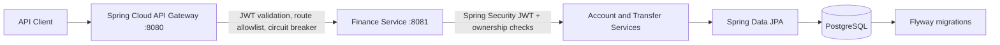

# Secure Finance Platform

A portfolio-grade financial account and internal-transfer API built with Java 21, Spring Boot, Spring Security OAuth2 Resource Server, Spring Cloud Gateway, PostgreSQL, Flyway, and Docker Compose.

**Scope:** educational portfolio software with simulated balances and transfers. It is not connected to a bank, does not move real money, and is not certified for production financial use.

## Architecture



## Implemented features

- JWT bearer-token authentication at the gateway and service, validating issuer and audience
- Deny-by-default security rules and authenticated `/api/v1/**` routes
- Account creation and account listing scoped to the authenticated token subject
- Internal transfers with amount/currency validation, pessimistic row locking, and a single database transaction
- Account ownership checks, immutable transfer references, and recent transfer history
- PostgreSQL constraints, indexes, optimistic version column, and Flyway schema migration
- Gateway route allowlist, connection/response timeouts, and Resilience4j circuit-breaker fallback
- Health/metrics actuator endpoints and CI build workflow

## Requirements

- Java 21
- Maven 3.9+
- Docker Desktop (for PostgreSQL + gateway stack)
- An OAuth 2.0 / OpenID Connect issuer that can mint JWTs with audience `finance-api`

The application intentionally does not ship a token issuer or hardcoded demo JWTs. Use an identity provider you control for local integration tests.

## Docker setup

1. Copy `.env.example` to `.env`.
2. Replace the placeholders with a strong local database password, a real issuer URL, and the audience configured in that issuer.
3. Run:

```bash
docker compose up --build
```

The gateway listens on `http://localhost:8080`; the service listens on `http://localhost:8081`. For normal client calls, use the gateway address. Do not expose the service port publicly in a hosted deployment; the compose mapping is for local development only.

## API

All API calls require `Authorization: Bearer <access-token>` from the configured identity provider.

| Method | Endpoint | Purpose |
|---|---|---|
| POST | `/api/v1/accounts` | Create account for authenticated subject |
| GET | `/api/v1/accounts` | List caller-owned accounts |
| GET | `/api/v1/accounts/{id}` | Get caller-owned account |
| POST | `/api/v1/transfers` | Transfer between accounts (caller must own source) |
| GET | `/api/v1/accounts/{id}/transactions` | Recent transfers for caller-owned account |

### Example: create account

```bash
curl -X POST http://localhost:8080/api/v1/accounts \
  -H "Authorization: Bearer $TOKEN" \
  -H "Content-Type: application/json" \
  -d '{"currency":"CAD","openingBalance":500.00}'
```

### Example: transfer

```bash
curl -X POST http://localhost:8080/api/v1/transfers \
  -H "Authorization: Bearer $TOKEN" \
  -H "Content-Type: application/json" \
  -d '{"fromAccountId":1,"toAccountId":2,"amount":25.00,"currency":"CAD"}'
```

The source account must belong to the authenticated subject. The destination must exist and be active. Both account currencies must match the transfer currency.

## Security and production-hardening notes

This is a portfolio reference implementation, **not a “full-proof” or production-certified banking system**. Before production, it needs independent security review and, at minimum:
- identity-provider configuration, MFA, least-privilege scopes/roles, key rotation and token-lifetime policy
- idempotency keys and replay-safe transfer handling
- explicit transfer authorization/consent rules for recipient ownership
- ledger-based double-entry accounting, reconciliation, reversal workflows, and audit trail
- rate limiting, WAF, TLS termination, secrets manager, network policies, and private service-to-service connectivity
- reliable outbox/event publication, distributed tracing, alerts, backup/restore and disaster-recovery tests
- concurrency and fault-injection tests, dependency/image scanning, SBOM, and penetration testing
- compliance and legal review for any real financial use

## Build and test

```bash
mvn clean verify
```

The context test uses H2 and test-only configuration. The Docker deployment uses PostgreSQL and Flyway. Verify the build and exercise the endpoints with an identity-provider token before presenting this project as runnable.

## Resume-ready description (use after testing)

Built a secure financial account and transfer API using Java 21, Spring Boot, OAuth2/JWT resource-server security, Spring Cloud Gateway, PostgreSQL, and Flyway. Implemented authenticated account ownership checks, transactional transfers with database row locking, validation, gateway circuit breaking, and Docker-based local deployment.
